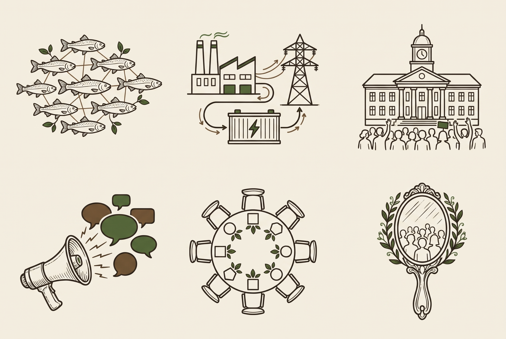

# Illustrations for the LinkedIn film on MiroFish

Model: gemini-3-pro-image, seed 2031. 

Brief common to all: A sheet of six illustrations in a regular grid of three columns and two rows, each centred in its own cell with generous space, no labels, no text, no letters, no frames. Same detailed botanical line style as the attached sheet: bark brown #2a2219 lines with moss green #3d5a2a accents, flat, on plain warm off-white #f3eee3. No gradient, no shadow, no 3D.

## 1. use-cases

Left to right, top to bottom: (1) a school of small fish swimming together, each fish linked to its neighbours by fine lines like a network; (2) a factory, a battery container and an electricity pylon linked by a curved line with small arrows; (3) a town hall with a small crowd of people in front of it, some raising hands; (4) a megaphone whose sound waves turn into speech bubbles; (5) a round negotiation table seen from above with seats of different shapes around it; (6) a hand mirror reflecting a small crowd of people.

