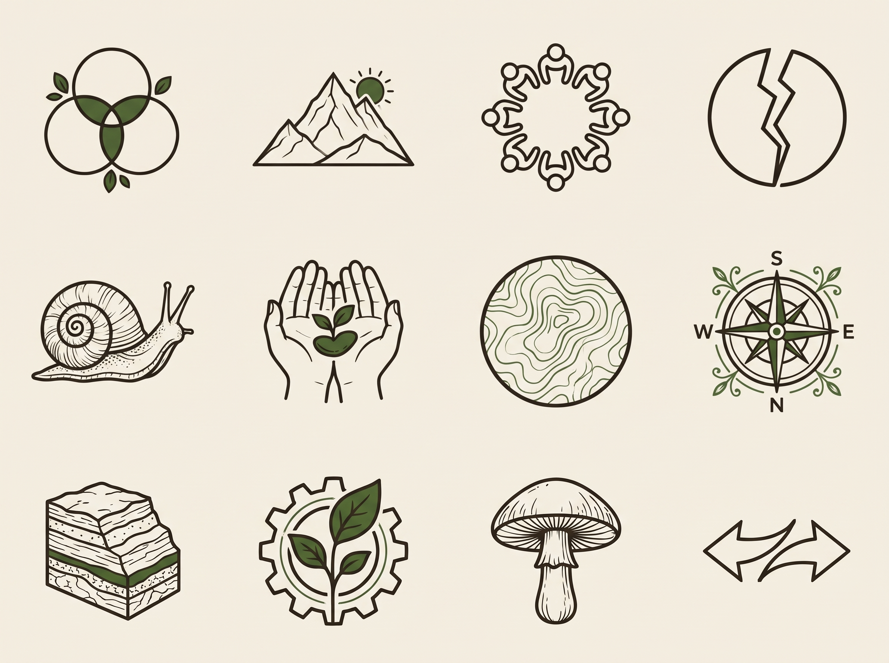
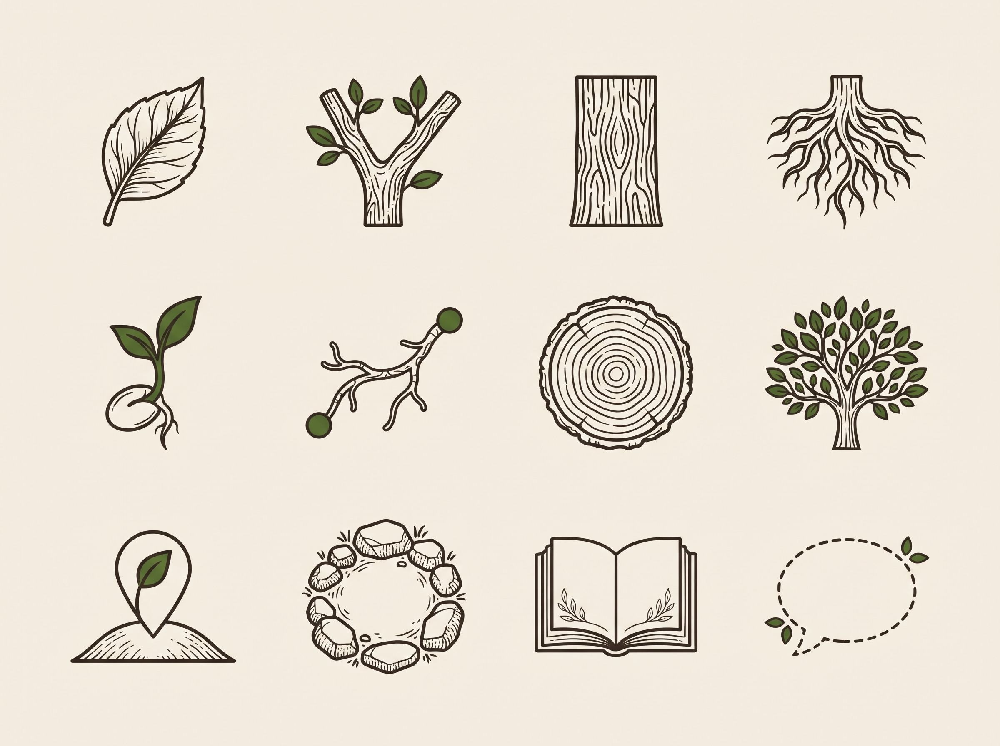
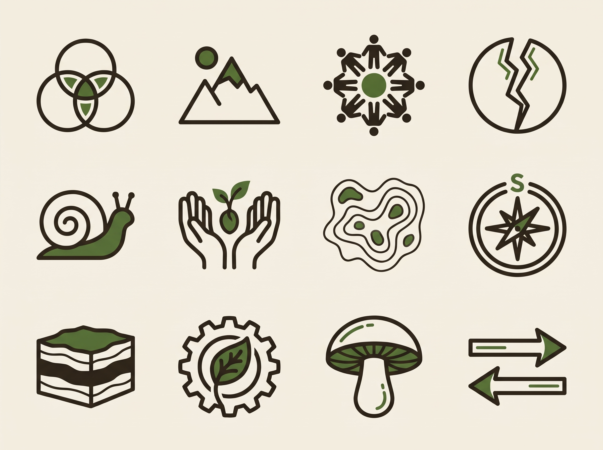

# Icon set, second round: Gemini sheets in the style of the logo

Model: gemini-3-pro-image, seed 2026. Each sheet is a grid of twelve icons, so that the style holds across the set. The logo is attached as the style reference.

Brief common to all: A sheet of twelve icons in a regular grid of four columns and three rows, each icon centred in its own cell with generous space, no labels, no text, no frames. Same drawing style as the attached logo: botanical, detailed but clean line drawing, bark brown #2a2219 lines of even weight with moss green #3d5a2a accents, flat, on plain warm off-white #f3eee3. No gradient, no shadow, no 3D.

## 1. branch-emblems

The twelve icons, in this order, left to right and top to bottom: three overlapping circles (the three ecologies); a mountain with a small sun; a circle of people in assembly seen from above; a circle split by a crack (the metabolic rift); a snail; two cupped hands holding a seed; a contour map; a compass with south pointing up; layered rock strata; a gear with a leaf growing through it; a mushroom; two arrows facing opposite ways.

## 2. concept-glyphs

The twelve icons, in this order, left to right and top to bottom: a single leaf; a forked branch; a tree trunk with bark; roots; a seed sprouting; a fungal thread (hypha) linking two dots; tree rings seen in cross-section; a tree canopy; a map pin on a hill; a forest clearing with a circle of stones; an open book; a dashed speech bubble.

## 3. branch-emblems-alt

Another version of the same twelve icons, simpler and bolder so that they read at 24 pixels, in this order: three overlapping circles; a mountain with a small sun; a circle of people in assembly seen from above; a circle split by a crack; a snail; two cupped hands holding a seed; a contour map; a compass with south pointing up; layered rock strata; a gear with a leaf growing through it; a mushroom; two arrows facing opposite ways.

