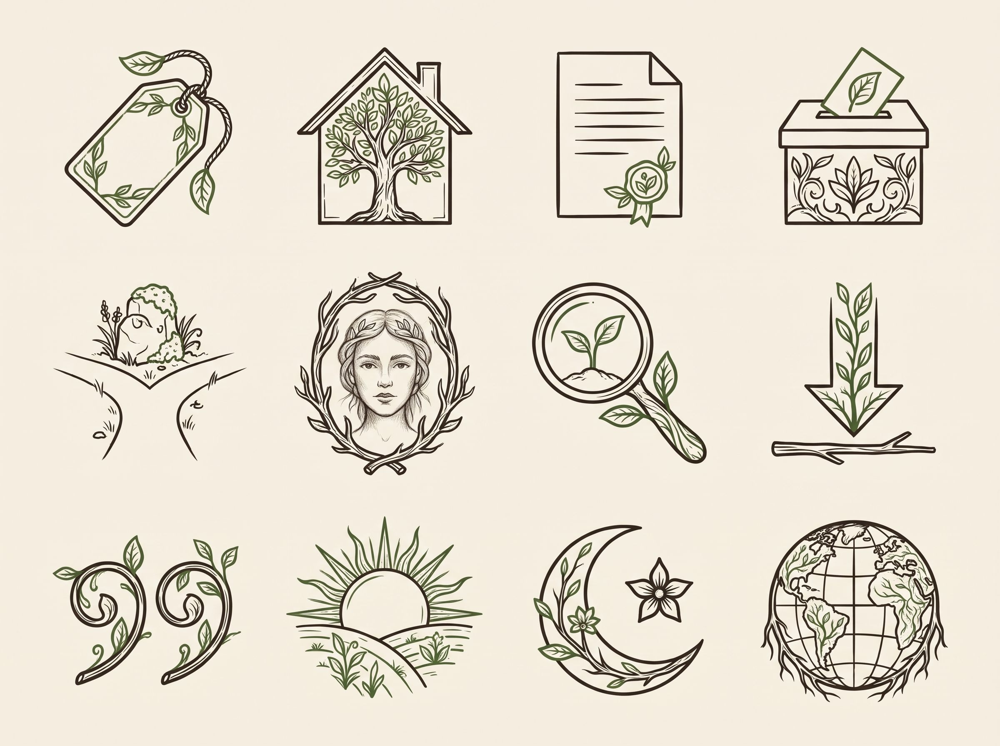

# Icon set, third round: the missing emblems and interface glyphs in both styles

Model: gemini-3-pro-image, seed 2027. Same grid and order in both sheets. The style reference is the matching sheet of the second round.

Brief common to all: A sheet of twelve icons in a regular grid of four columns and three rows, each icon centred in its own cell with generous space, no labels, no text, no frames. Bark brown #2a2219 lines with moss green #3d5a2a accents, flat, on plain warm off-white #f3eee3. No gradient, no shadow, no 3D.

## 1. detailed

Draw these twelve icons in exactly the same detailed botanical line style as the first attached sheet, in this order, left to right and top to bottom: a price tag (market liberals); a house with a tree inside it (conservatives); a document page with a small round seal (a sourced text); a ballot box with a paper going in (a party programme); a path forking in two at a stone (an axiom that divides); an oval frame holding a pencil portrait of a face (a portrait); a magnifying glass (search); an arrow pointing down onto a line (download); a pair of quotation marks; a sun rising over a horizon (day theme); a crescent moon with a small star (night theme); a globe with meridians (language).

## 2. bold

Draw these twelve icons in exactly the same simple, bold style as the second attached sheet, readable at 24 pixels, with moss green fills where useful, in this order, left to right and top to bottom: a price tag (market liberals); a house with a tree inside it (conservatives); a document page with a small round seal (a sourced text); a ballot box with a paper going in (a party programme); a path forking in two at a stone (an axiom that divides); an oval frame holding a pencil portrait of a face (a portrait); a magnifying glass (search); an arrow pointing down onto a line (download); a pair of quotation marks; a sun rising over a horizon (day theme); a crescent moon with a small star (night theme); a globe with meridians (language).

