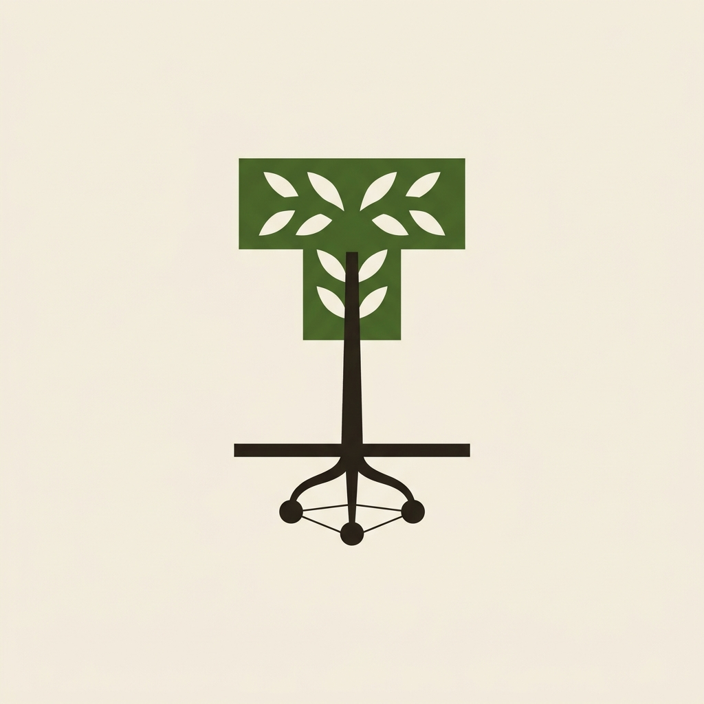
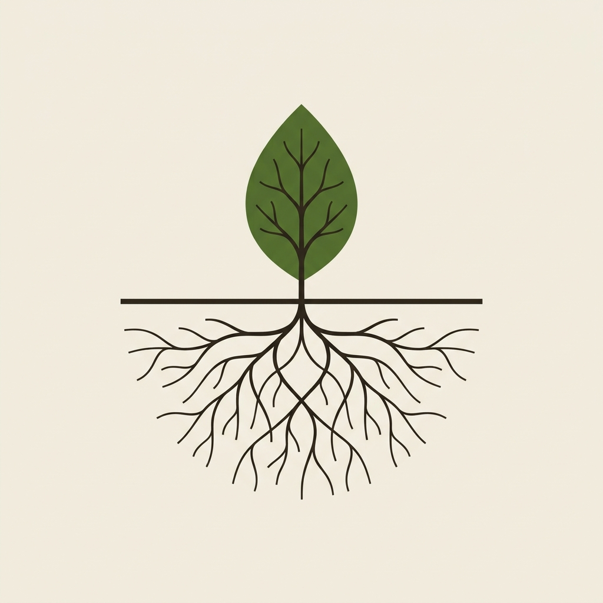
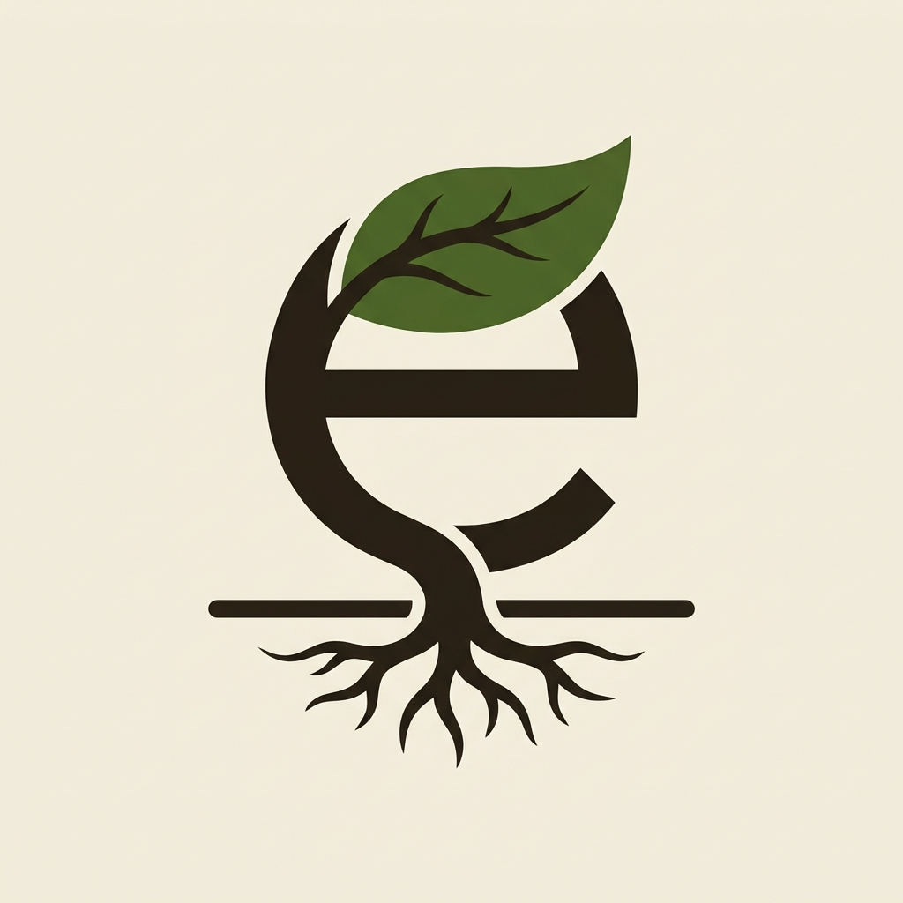
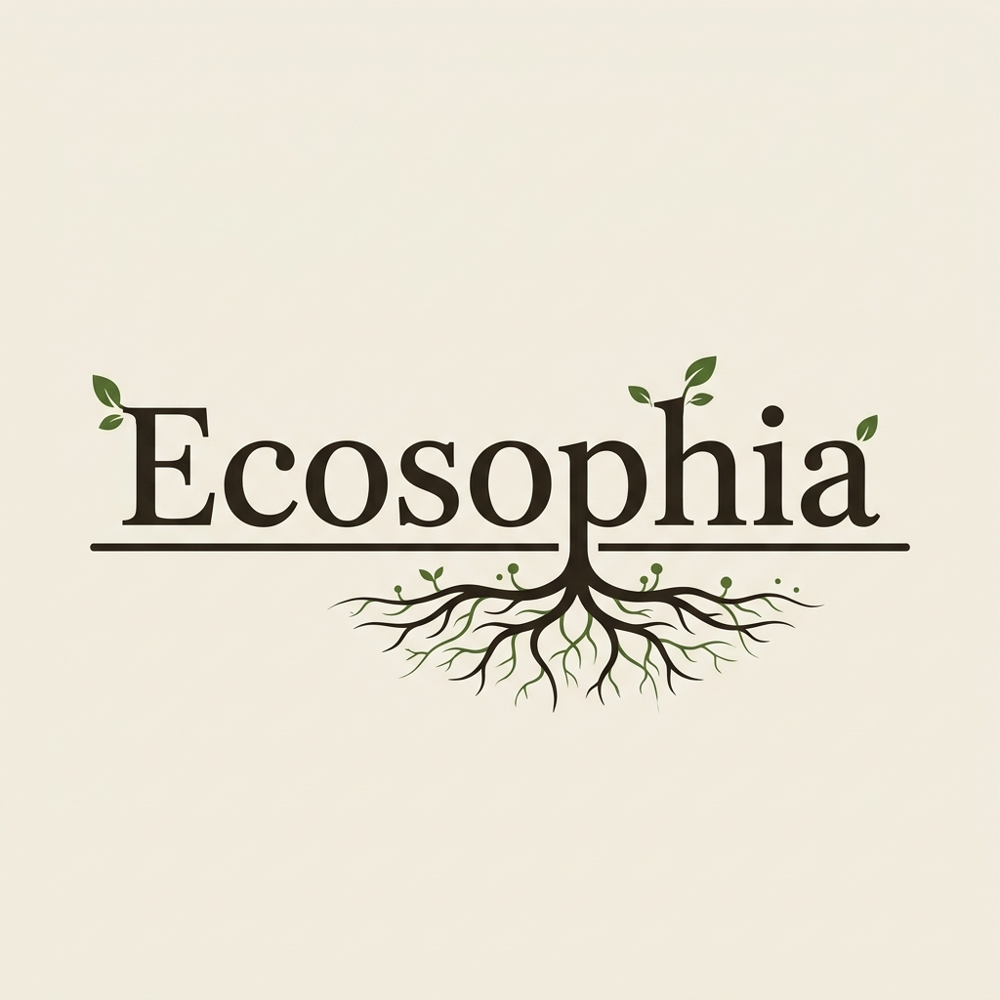
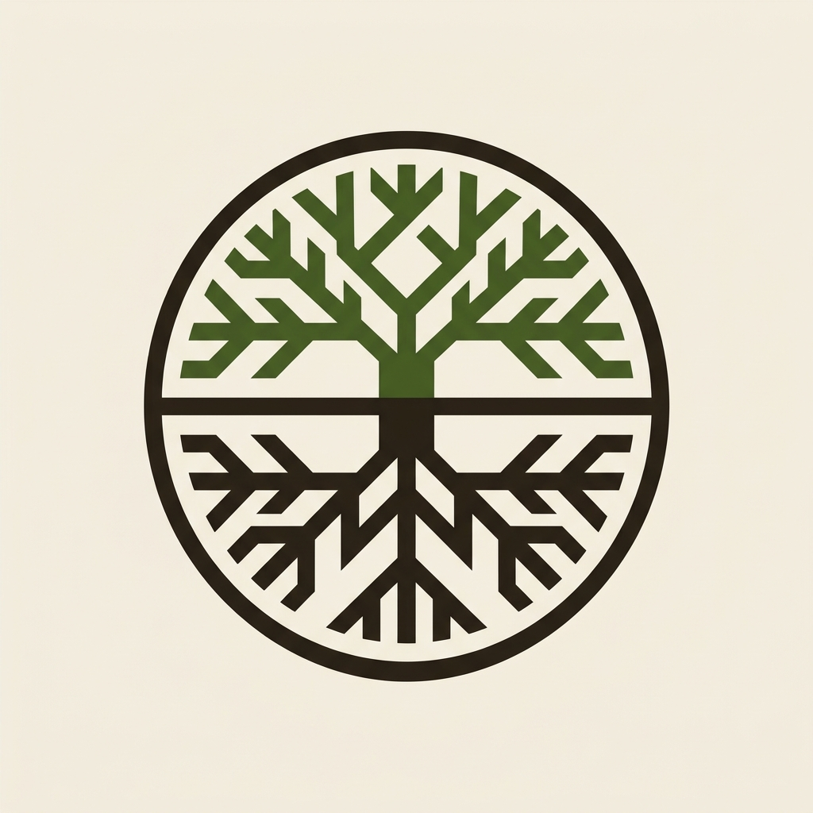
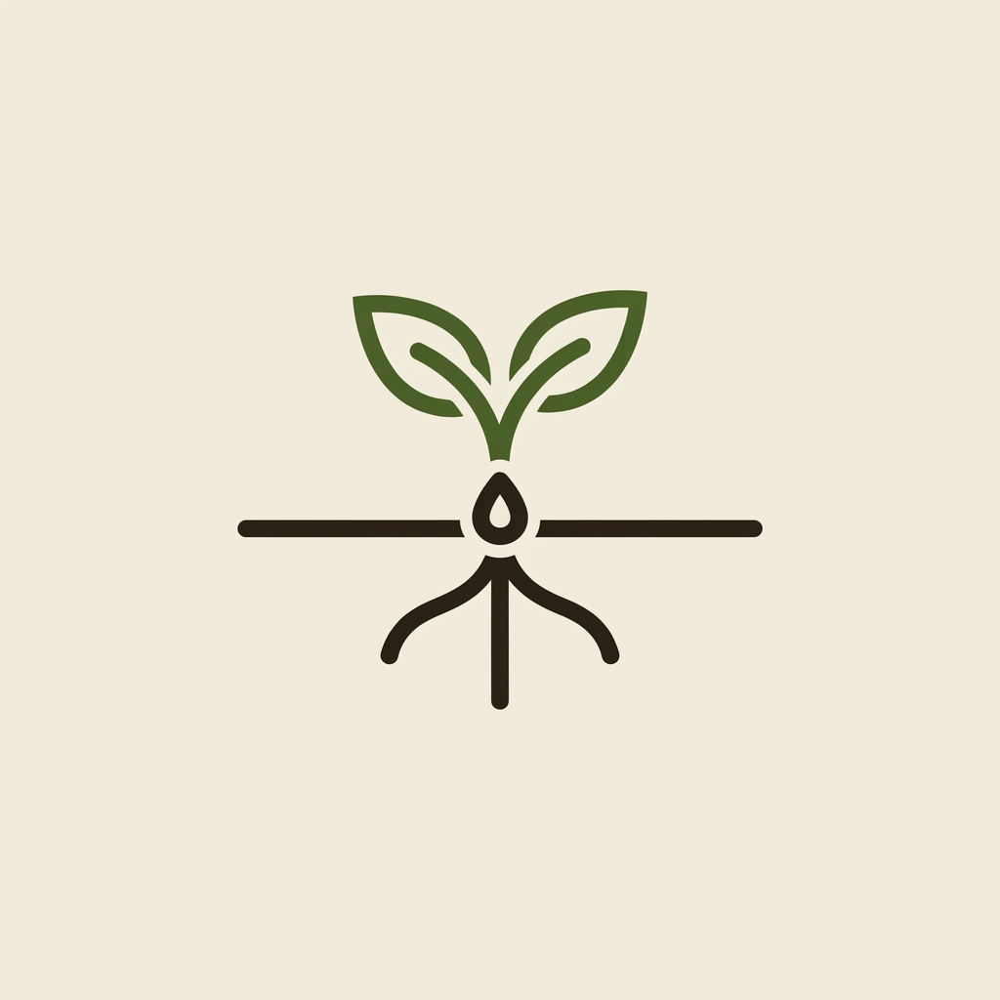

# Logo concepts, 2026-11-12

Model: gemini-nano-banana-2.1, seed 1912. Concepts to choose from, not logos: the chosen one is redrawn as SVG.

Brief common to all: A logo for Ecosophia, a bilingual website that maps the thinkers of political ecology as one tree: precursors in the roots, founding texts in the trunk, schools of thought as branches, authors as leaves, and underground a mycelium of threads showing who influenced whom. Flat vector style, two colours at most: dark bark brown #2a2219 and moss green #3d5a2a on warm off-white paper #f3eee3. Simple, geometric, readable at 32 pixels, no gradient, no shadow, no 3D, no photo, no mockup, centred on a plain background.

## 1. tree-ground-roots

A symbol only: a small tree whose crown is a T shape, standing on one horizontal ground line, with roots below that end in three dots joined by thin threads.

## 2. leaf-mycelium

A symbol only: a single leaf above a horizontal line, and below the line a fine network of threads that mirrors the veins of the leaf.

## 3. monogram-e

A symbol only: a lowercase letter e drawn so that its curve becomes a leaf and its tail becomes a root under a ground line.

## 4. rooted-wordmark

A wordmark: the word Ecosophia in a classic serif, the letters standing on a ground line, with the descender of the p turning into roots below the line.

## 5. canopy-circle

A symbol only: a circle cut by a horizontal line, the upper half filled with a stylised canopy of branches, the lower half with roots, both halves mirroring each other.

## 6. seed-sprout

A symbol only: a seed on a ground line opening into two leaves above and three roots below, in very few strokes.

