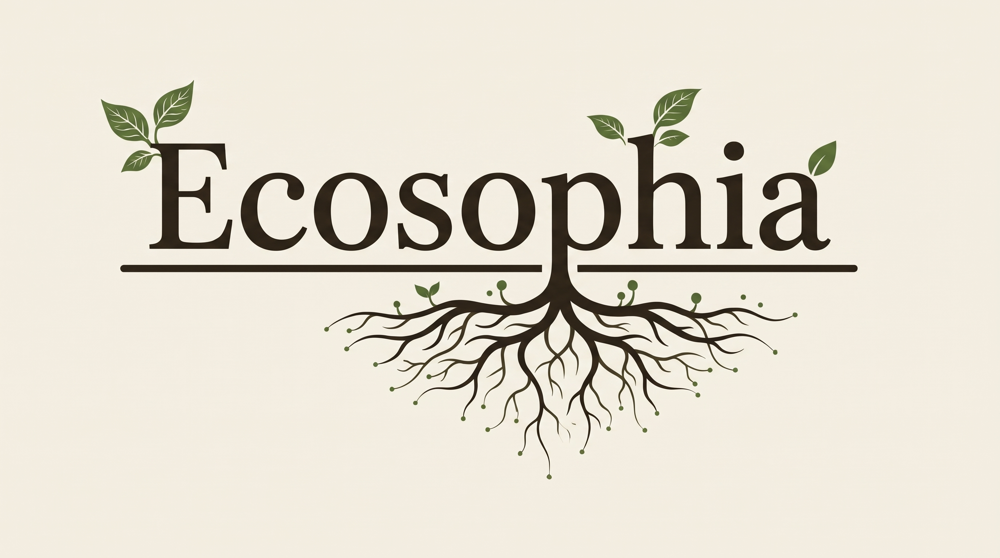
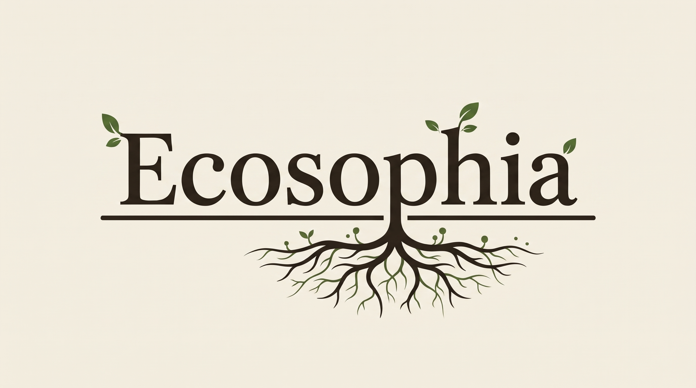
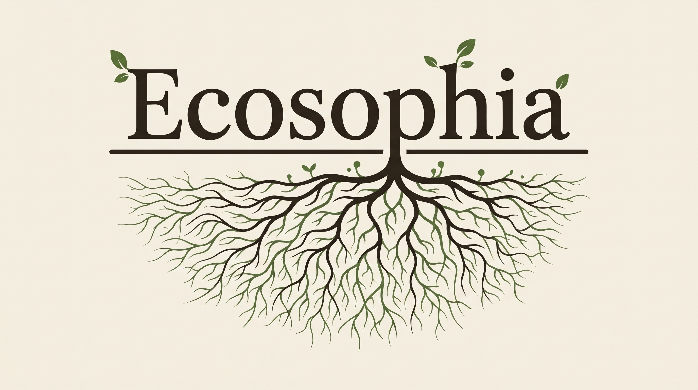
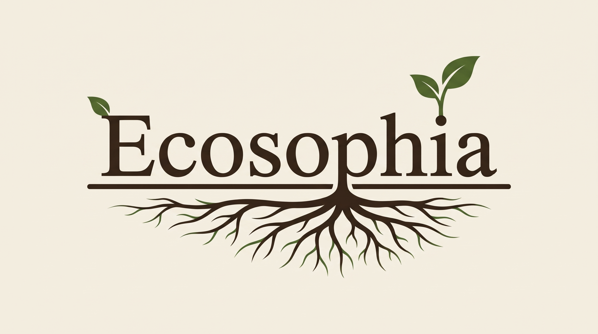
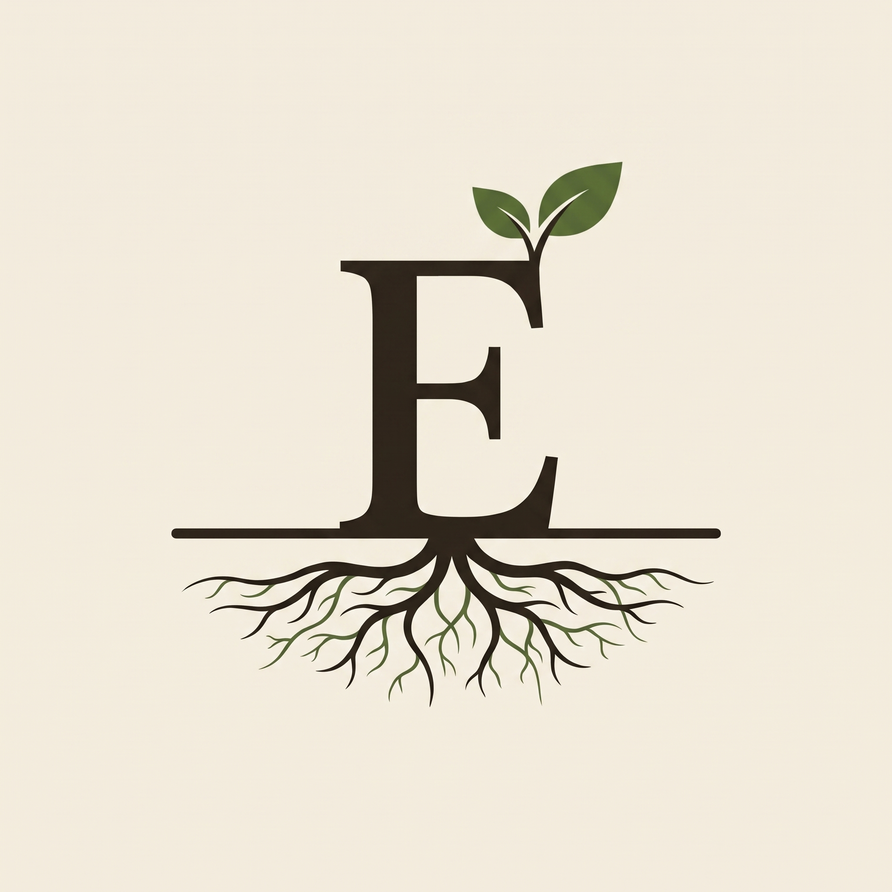
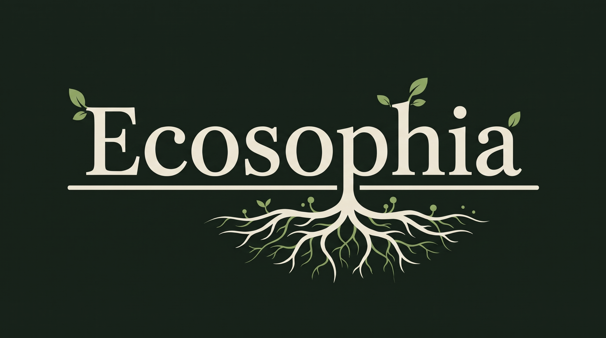

# Logo, second round: refinements of concept 4

Model: gemini-3-pro-image, seed 2026. The first image attached is concept 4 of the first round, which was chosen.

Brief common to all: Keep the idea of the attached logo: the word Ecosophia in a classic, warm serif standing on one horizontal ground line, the descender of the p running through the line, a root system spreading below the line from the p, and small leaves sprouting on top of letters. Two colours only: dark bark brown #2a2219 for the letters, the line and the roots, moss green #3d5a2a for leaves and fine root tips, on a plain warm off-white background #f3eee3. Flat vector look with crisp clean edges, no gradient, no texture, no shadow, no 3D, no mockup, no other text, logo centred with generous margins.

## 1. refined

Redraw the attached logo with more care and detail: finer, more organic roots that branch three or four times and taper to hairlines, a few roots ending in tiny moss-green dots like a mycelium network, two delicate sprouts with veined leaves on the E and between the i and the a.

## 2. engraved

Redraw the attached logo in the manner of a fine botanical engraving: elegant serif letters with subtle ink traps, roots drawn with precise thin strokes that branch richly and symmetrically under the word, small leaves on the E, the h and the a.

## 3. mycelium

Redraw the attached logo so that the roots below the line become a dense, beautiful network: roots in bark brown that divide into a fine web of moss-green threads joining one another, like a mycelium, wider than the word itself.

## 4. balanced

Redraw the attached logo with perfect balance: the roots spreading below the whole width of the word as a mirror of a canopy, a single young sprout with two leaves rising from the dot of the i, and a small leaf on the E. Very clean, readable at small size.

## 5. compact-mark

From the attached logo, draw a square app icon: only the capital E of the same serif, standing on the ground line, a sprout with two leaves growing from its top and detailed roots with moss-green tips below the line.

## 6. night

Redraw the attached logo, refined and detailed, in cream #ece6d8 letters and roots with light moss #8fae6a leaves and root tips, on a deep green-black background #16201a.

